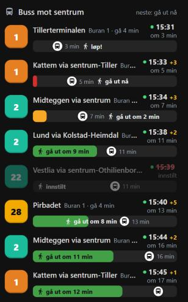
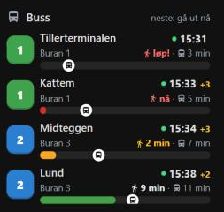
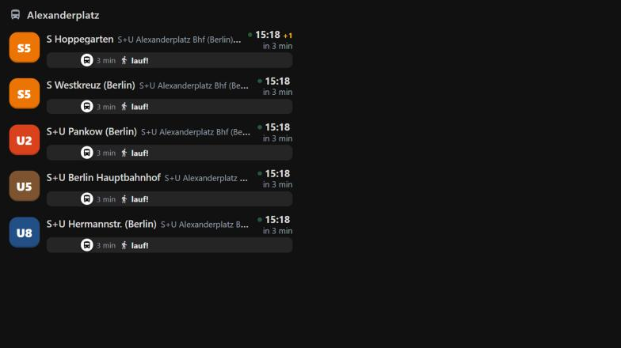

# Bus Board Card

[](https://my.home-assistant.io/redirect/hacs_repository/?owner=andersgar&repository=bus-board-card&category=plugin)
[](https://github.com/andersgar/bus-board-card/actions/workflows/validate.yml)
[](https://github.com/andersgar/bus-board-card/releases)

A Home Assistant dashboard card that shows upcoming public transport departures
from the stops near you, one row per departure, each with a bar that counts down
to **the moment you have to leave the house** to catch it.



- **Leave-the-house bars.** Walk time to each stop plus a door buffer are
  subtracted from the real-time departure. Green while you have time, amber at
  3 minutes, red at 1 minute, then *run!*, then *too late*, then the row drops.
- **Real-time.** Expected vs scheduled time, delay in minutes, blinking dot for
  live data, strike-through for cancellations. Countdowns tick every 5 s in the
  browser; data refreshes every 30 s.
- **No YAML needed.** Give the card a stop id and it fetches departures itself
  (Entur for Norway, [Transitous](https://transitous.org) for most other
  countries). Or point it at any Home Assistant sensor that lists departures.
- **Route selection you can automate.** Which `line@quay` combinations are
  shown can come from an `input_text`, so an automation can switch between a
  morning set and a daytime set. Walk minutes can come from `input_number`s.
- **Official line colours** when the data source publishes them (Ruter, VBB,
  …); a stable palette otherwise; override anything with `line_colors`.
- Compact tile and full pop-up variants, English / Norwegian / Swedish /
  German strings, works in sections views, masonry and bubble-card pop-ups.



## Installation

### HACS (recommended)

1. HACS → ⋮ (top right) → **Custom repositories**.
2. Repository `https://github.com/andersgar/bus-board-card`, type **Dashboard**, **Add**.
3. Search for *Bus Board Card*, **Download**, reload the page when asked.

Or click the badge at the top of this page. HACS registers the dashboard
resource automatically (storage-mode dashboards).

### Manual

Download `bus-board-card.js` from the [latest release](https://github.com/andersgar/bus-board-card/releases)
into `config/www/bus-board-card/` and add a dashboard resource
`/local/bus-board-card/bus-board-card.js` of type *JavaScript module*.

## Quick start (no sensors required)

```yaml
type: custom:bus-board-card
title: Buss mot sentrum
source:
  provider: entur              # Norway. Use `transitous` elsewhere, see below.
  door_buffer_min: 1           # minutes from "leave now" until you are out the door
  stops:
    - id: NSR:StopPlace:60447  # Buran
      walk_min: 4
      lines: ["1", "22"]       # optional filter
      quays: ["103009"]        # optional filter (quay 1, toward the city centre)
    - id: NSR:StopPlace:271    # Lademoen stasjon
      walk_min: 6
max_rows: 6
```

**Finding stop ids (Norway):** search on
[stoppested.entur.org](https://stoppested.entur.org) or call
`https://api.entur.io/geocoder/v1/autocomplete?text=Buran&layers=venue`.
A `NSR:StopPlace:…` id gives every platform at the stop; a `NSR:Quay:…` id
gives one platform. The quay ids in `quays:` can be given as the full id or
just the number.

**Everywhere else:** use `provider: transitous`, which serves departures for
most of Europe and large parts of the world without an API key. Find the stop id with
`https://api.transitous.org/api/v1/geocode?text=Alexanderplatz&type=STOP`
(ids look like `de-VBB_de:11000:900100003` or `se-Trafiklab_740000001`).
Transitous is run by volunteers for non-commercial use; be reasonable with the
refresh interval. See [docs/providers.md](docs/providers.md) for the full
picture, including what to do in countries where the only API needs a key.

## Configuration

### Card options

| Option | Default | Description |
|---|---|---|
| `entity` | – | Home Assistant entity whose `list` attribute holds departures (entity mode, see below). Either `entity` or `source` is required. |
| `source` | – | Fetch departures directly in the browser (see *Source options*). |
| `title` | localized "Departures" | Header text. |
| `show_header` | `true` | Title row with the "next: leave in N min" summary. |
| `max_rows` | `6` | Rows shown (rows that do not fit in a height-limited tile are hidden). |
| `compact` | `false` | Smaller badges and bars for a tile on a busy view. |
| `label` | `bar` (`inline` when compact) | `bar` = text inside the countdown bar; `inline` = walker/bus icons with minutes in the time column and a thin bar. |
| `scale_min` | `20` | The bar spans 0–N minutes. |
| `show_stop` | `true` | Stop name and walk time under the destination (bar layout). |
| `short_dest` | `true` in inline layout | `Kattem` instead of `Kattem via sentrum-Tiller` (full text in the tooltip). |
| `drop_after` | `20` | Seconds a *too late* row stays before it disappears. |
| `animations` | `true` | `false` for info screens: no bar transitions, no blinking dot. |
| `bar_height` | `10` | Bar height in px (inline layout). |
| `line_colors` | `{}` | Line number → badge colour, e.g. `{ "1": "#3fa34d", "22": "#f2a900" }`. Overrides colours from the data source. |
| `stop_labels` | `{}` | Quay id → label shown under the destination, e.g. `{ "103009": "Buran 1" }`. |
| `language` | HA user language | `en`, `nb`, `sv`, `de`. |
| `tap_action` | – | Standard HA action (`navigate`, `url`, `more-info`, `call-service`, …). |
| `grid_options` | `{ columns: 12, rows: auto }` | Size in sections views. |

### Source options

| Option | Default | Description |
|---|---|---|
| `provider` | `entur` | `entur` (any OpenTripPlanner Transmodel API), `transitous`, or a provider registered at runtime ([docs/providers.md](docs/providers.md)). |
| `url` | provider default | Override the API endpoint, e.g. a self-hosted OTP. |
| `client_name` | `homeassistant-bus-board-card` | Sent as `ET-Client-Name` to Entur, as they ask. |
| `stops` | required | List of stops, see below. |
| `door_buffer_min` | `0` | Minutes between "leave now" and being out of the door. A number or an `input_number.*` entity id. |
| `refresh` | `30` | Seconds between fetches. Cards with identical sources share one fetch; polling pauses while the tab is hidden. |
| `time_range` | `5400` | Seconds ahead to look. |
| `departures_per_stop` | `40` | Departures requested per stop. |
| `watch` | – | Only show these `line@quay` tokens, e.g. `["1@103009", "22@103009"]`. |
| `watch_entity` | – | Read the tokens from an entity's state instead (comma separated), e.g. `input_text.bus_watch`. Lets automations decide which routes are shown. |

Per stop:

| Option | Default | Description |
|---|---|---|
| `id` | required | Stop id in the provider's format (`NSR:StopPlace:…`, `NSR:Quay:…`, `de-VBB_…`). |
| `name` | from the API | Label shown under the destination (the quay code is appended). |
| `walk_min` | `3` | Walking time to the stop. A number or an `input_number.*` entity id. |
| `quay_walk_min` | `{}` | Walk minutes per quay when platforms are far apart. |
| `quays` | all | Only these quay ids. |
| `lines` | all | Only these line numbers. |
| `exclude_lines` | `[]` | Hide these line numbers. |
| `quay_labels` | `{}` | Quay id → label (overrides `name`). |

### Entity mode

If you prefer the data to live in Home Assistant (history, automations that
notify you, a dashboard that works for everyone on the network), feed the card
from a sensor instead:

```yaml
type: custom:bus-board-card
entity: sensor.bus_departures
```

The sensor's `list` attribute must hold departures of the shape documented in
[docs/home-assistant-sensors.md](docs/home-assistant-sensors.md). A ready-made
[package for Entur](homeassistant/packages/bus_board_entur.yaml) builds exactly
that from a `rest` sensor and a template sensor, with the route selection in an
`input_text` and walk times in `input_number`s. Any other integration whose
attributes you can reshape with a template sensor works too.

## Examples

**Small tile on the home view that opens a pop-up** (bubble-card pop-up with
`hash: "#bus_board"` holding the full card):

```yaml
type: custom:bus-board-card
entity: sensor.bus_departures
title: Buss
compact: true
max_rows: 3
tap_action:
  action: navigate
  navigation_path: "#bus_board"
grid_options:
  columns: 6
  rows: auto
```

**Route selection driven by automations.** Keep the tokens in an `input_text`
and let the card read it; an automation that writes `22@103009` on weekday
mornings and a longer list otherwise changes the board instantly:

```yaml
source:
  provider: entur
  watch_entity: input_text.bus_watch
  door_buffer_min: input_number.bus_door_buffer
  stops:
    - { id: NSR:StopPlace:60447, walk_min: input_number.bus_walk_buran }
    - { id: NSR:StopPlace:271, walk_min: input_number.bus_walk_lademoen }
```

**Berlin, German strings** (Transitous data, VBB's line colours):



```yaml
type: custom:bus-board-card
language: de
source:
  provider: transitous
  stops:
    - id: de-VBB_de:11000:900100003   # S+U Alexanderplatz
      name: Alexanderplatz
      walk_min: 5
      exclude_lines: ["S3", "S5"]
```

**Information screen** (no animations, fixed height, many rows):

```yaml
animations: false
max_rows: 12
label: bar
grid_options: { columns: full, rows: 10 }
```

## Data sources and other countries

| Country / API | Provider | Key | Status |
|---|---|---|---|
| Norway – Entur JourneyPlanner | `entur` | no | built in, real-time, line colours |
| Most of Europe and more – Transitous (MOTIS) | `transitous` | no | built in, real-time where the feed has it, non-commercial use |
| Any OpenTripPlanner 2 with the Transmodel API | `entur` + `url` | – | built in |
| Sweden – SL Transport, Switzerland – transport.opendata.ch, Belgium – iRail, UK – TfL | – | no | key-free and browser-friendly; see docs for how to add a provider in ~30 lines |
| Finland (Digitransit), Sweden (Trafiklab), Denmark (Rejseplanen), Germany (HVV), … | entity mode | yes | use a `rest:` sensor or the HA integration and reshape with a template |

Details, verified endpoints and the provider API are in
[docs/providers.md](docs/providers.md).

## Development

```bash
npm install
npm run build        # bundles src/ into dist/bus-board-card.js
npm run watch
npm run dev          # static server on :8765, open /dev/ for the test harness
```

`dev/index.html` renders the card from a fixture (entity mode) and live from
Entur and Transitous (source mode). `dist/` is committed so HACS can install
straight from the default branch; releases attach the same file as an asset.

## Credits and data licences

Departure data from [Entur](https://developer.entur.org) (NLOD licence) and
[Transitous](https://transitous.org) (see their [sources](https://transitous.org/sources/)).
Card by Anders Garberg, MIT licence.
